# Rapport TP – Configuration et utilisation de VNC et noVNC

**Karol Birane Fall – L3 GLSI – 25 novembre 2026**

| | |
|---|---|
| **Établissement** | DGI-ESP / UCAD |
| **Classe** | L3 GLSI |
| **Module** | Services Réseaux Avancés |
| **Enseignant** | Dr. GUEYE |
| **Étudiant** | Karol Birane Fall |
| **Année** | 2026-2027 |

---

## Présentation

Les deux TP ont été réalisés avec succès. Un serveur VNC (TigerVNC + bureau XFCE) a été installé sur une machine Linux, puis rendu accessible depuis un client VNC natif et depuis un navigateur web (noVNC). Dans les deux cas, l'accès est sécurisé par un tunnel SSH et les services démarrent automatiquement avec la machine.

**Objectifs :**
- configurer un serveur VNC pour une prise de contrôle distante sécurisée ;
- permettre cette prise de contrôle depuis un simple navigateur grâce à noVNC.

## Environnement de travail

| Machine | Rôle | Système | Adresse IP |
|---|---|---|---|
| VM Ubuntu (`karolfall`) | Serveur VNC, noVNC, SSH | Ubuntu 26.04.1 LTS (ARM64) | 192.168.64.18 |
| MacBook Air (machine hôte) | Client (TigerVNC Viewer, navigateur Chrome) | macOS | 192.168.64.1 |

**Adaptations par rapport au sujet :**

- **Écran `:2` / port 5902 au lieu de `:1` / 5901** : les écrans `:0` et `:1` sont déjà utilisés par la session graphique GNOME de la VM.
- **Configuration dans `~/.config/tigervnc/`** au lieu de `~/.vnc/` : c'est le nouvel emplacement utilisé par TigerVNC 1.15.
- **Fichier `xstartup` adapté** pour que XFCE fonctionne à côté de la session GNOME (voir Partie 1).
- **Websockify installé avec `apt`** au lieu de `pip3` : sur Ubuntu 26.04, `pip` n'a plus le droit de modifier les paquets Python du système.
- **Client TigerVNC Viewer** au lieu de RealVNC Viewer, qui exige désormais la création d'un compte.

---

# TP 1 – VNC

## Partie 1 – Installation et configuration du serveur VNC

### 1.1 Mise à jour et installation

```bash
sudo apt update && sudo apt upgrade -y
sudo apt install tigervnc-standalone-server -y
which vncserver
```

TigerVNC 1.15 est installé et la commande `vncserver` est disponible.

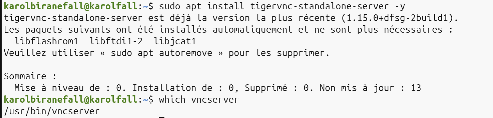

*Figure 1 – Installation de TigerVNC*

### 1.2 Installation du bureau XFCE

Le bureau GNOME de la VM fonctionne mal à travers VNC : on installe XFCE, un bureau léger utilisé uniquement pour la session VNC.

```bash
sudo apt install xfce4 xfce4-goodies -y
which startxfce4
```

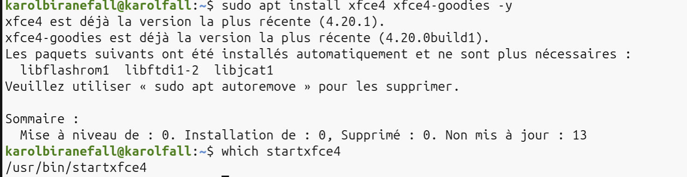

*Figure 2 – Installation de XFCE*

### 1.3 Fichier `xstartup` et lancement du serveur

Le fichier `xstartup` indique quel bureau lancer dans la session VNC. Le contenu proposé par le sujet a dû être complété pour fonctionner sur cette machine. Version finale :

```bash
cat > ~/.config/tigervnc/xstartup <<'EOF'
#!/bin/bash
unset SESSION_MANAGER
unset DBUS_SESSION_BUS_ADDRESS
unset WAYLAND_DISPLAY
export XDG_SESSION_TYPE=x11
export GDK_BACKEND=x11
xrdb $HOME/.Xresources
exec dbus-launch --exit-with-session startxfce4
EOF
chmod +x ~/.config/tigervnc/xstartup
touch ~/.Xresources
sudo apt install dbus-x11 -y
```

| Ligne | Rôle |
|---|---|
| `unset SESSION_MANAGER`, `unset DBUS_SESSION_BUS_ADDRESS` | Sépare XFCE de la session GNOME déjà ouverte par le même utilisateur |
| `unset WAYLAND_DISPLAY`, `XDG_SESSION_TYPE=x11`, `GDK_BACKEND=x11` | Force XFCE à s'afficher sur l'écran VNC (X11) et non sur l'écran GNOME (Wayland) |
| `exec dbus-launch --exit-with-session startxfce4` | Lance XFCE avec son propre bus D-Bus ; `exec` (au lieu de `&`) garde le script actif tant que le bureau tourne |

Lancement du serveur et vérification :

```bash
vncserver :2 -xstartup ~/.config/tigervnc/xstartup
vncserver -list
```

La session `:2` tourne sur le port **5902** (5900 + numéro d'écran).

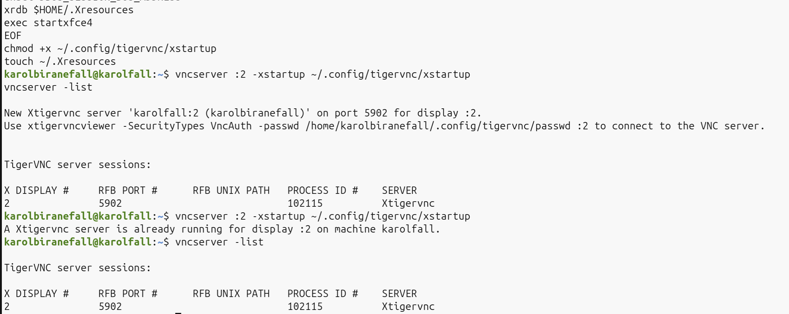

*Figure 3 – Création du fichier xstartup et lancement du serveur VNC*

### 1.4 Arrêt et relance pour les connexions réseau

Par défaut, TigerVNC n'accepte que les connexions venant de la machine elle-même. Pour la connexion directe de la Partie 2, on arrête le serveur et on le relance avec `-localhost no` :

```bash
vncserver -kill :2
vncserver :2 -xstartup ~/.config/tigervnc/xstartup -localhost no
ss -tlnp | grep 5902
```

Le serveur écoute sur `0.0.0.0:5902` : il est joignable depuis le réseau.

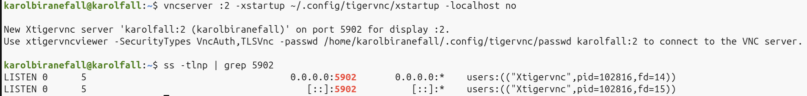

*Figure 4 – Serveur VNC relancé et à l'écoute sur le réseau*

---

## Partie 2 – Connexion depuis la machine cliente

### 2.1 Installation du client VNC

RealVNC Viewer a d'abord été essayé, mais il demande désormais un compte (essai gratuit puis payant).

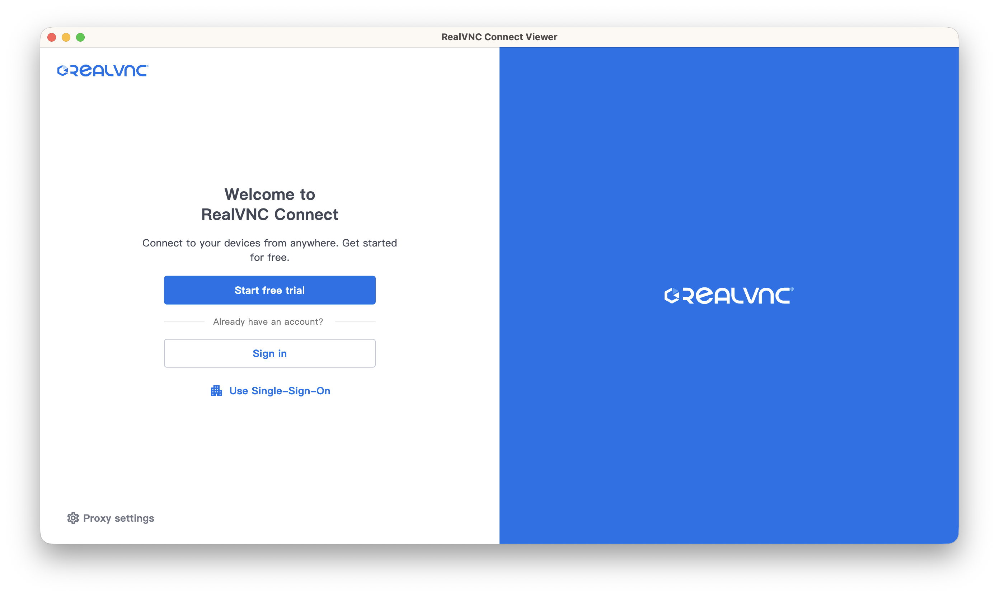

*Figure 5 – RealVNC Viewer exige un compte*

TigerVNC Viewer, gratuit et sans compte, a été installé à la place :

```bash
brew install --cask tigervnc-viewer
```

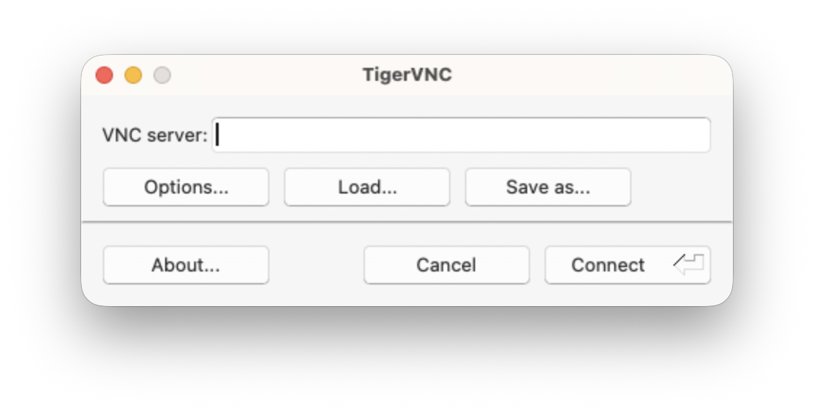

*Figure 6 – TigerVNC Viewer sur macOS*

### 2.2 Connexion au serveur VNC

Dans TigerVNC Viewer : adresse `192.168.64.18:2` (écran 2 = port 5902), puis le mot de passe VNC défini avec `vncpasswd`. Le bureau XFCE de la VM s'affiche sur le Mac.

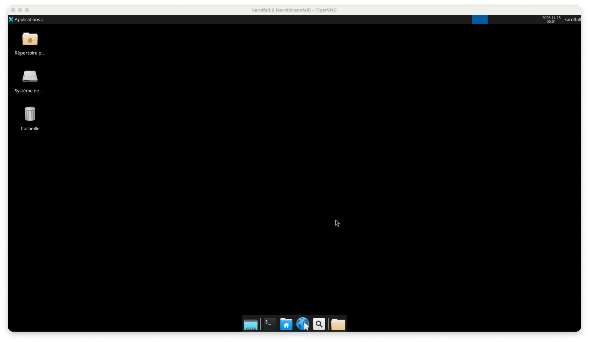

*Figure 7 – Bureau XFCE de la VM affiché dans TigerVNC Viewer*

### 2.3 Test de la connexion

Le gestionnaire de fichiers, un terminal et les paramètres ont été ouverts à distance. La commande `hostname` renvoie `karolfall` : c'est bien la VM qui est contrôlée.

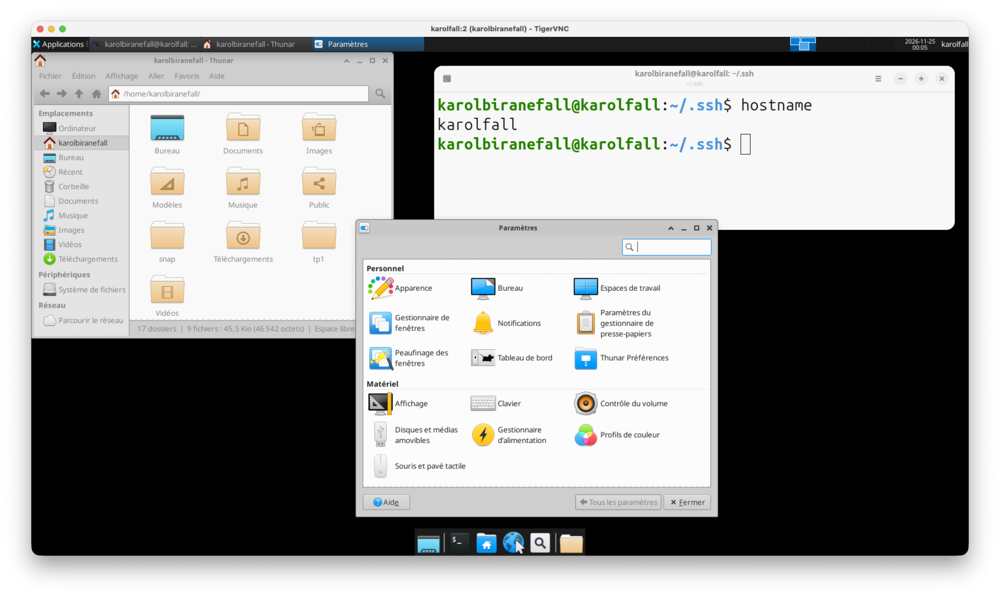

*Figure 8 – Gestionnaire de fichiers, terminal et paramètres ouverts à distance*

---

## Partie 3 – Sécurisation de la connexion VNC avec un tunnel SSH

Le protocole VNC ne chiffre pas les échanges. Le serveur VNC est donc relancé **sans** `-localhost no` : il n'écoute plus que sur `127.0.0.1:5902`, et la seule façon d'y accéder depuis le Mac est le tunnel SSH.

```bash
vncserver -kill :2
vncserver :2 -xstartup ~/.config/tigervnc/xstartup
```

### 3.1 Création du tunnel SSH

Depuis le Mac :

```bash
ssh -L 5902:localhost:5902 karolbiranefall@192.168.64.18
```

Le port 5902 du Mac est relié, à travers la connexion SSH chiffrée, au port 5902 de la VM.

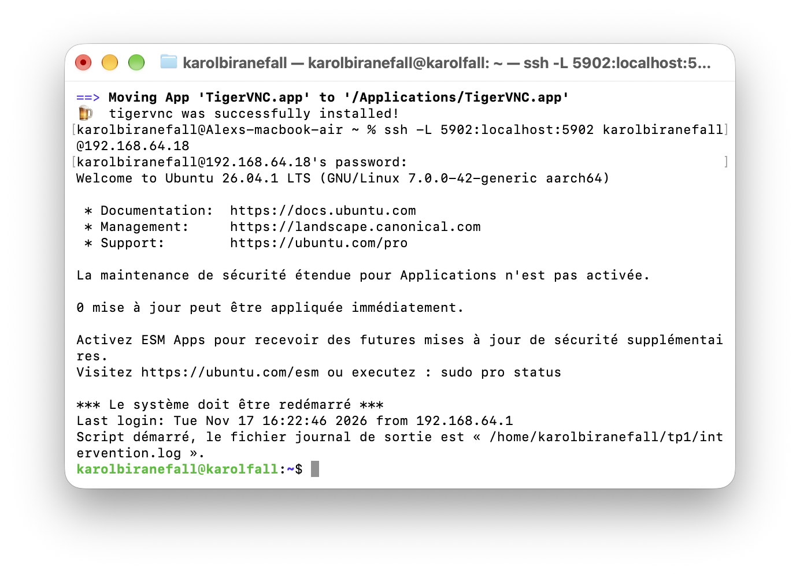

*Figure 9 – Ouverture du tunnel SSH vers le port 5902*

### 3.2 Connexion à travers le tunnel

Dans TigerVNC Viewer, l'adresse devient `localhost:2`. Le bureau s'affiche alors que le client ne contacte que le Mac lui-même : le trafic VNC passe dans le tunnel.

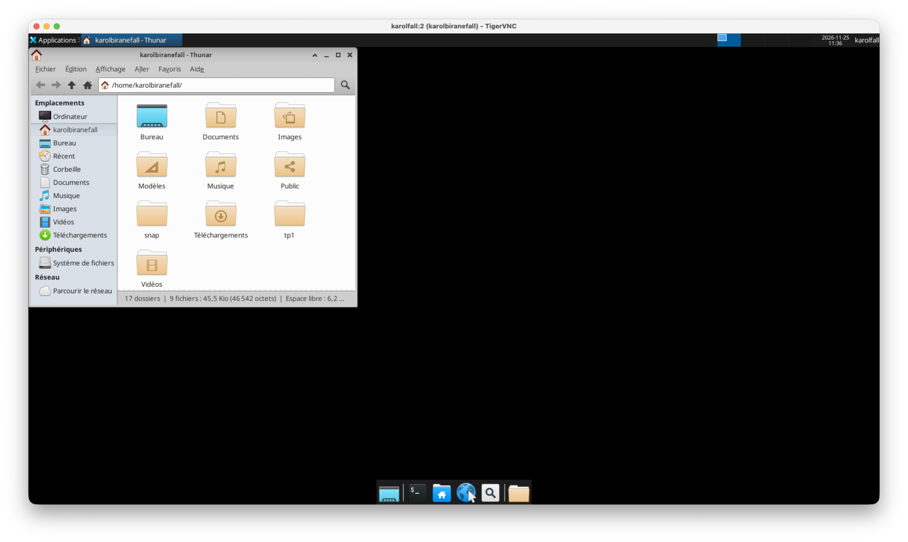

*Figure 10 – Bureau de la VM affiché via localhost:2*

### 3.3 Vérification du chiffrement

```bash
grep "Accepted" ~/.config/tigervnc/karolfall:2.log | tail -n 3
sudo journalctl -u ssh --since "30 min ago" | tail -n 5
ss -tn | grep -E ':22 |:5902 '
```

- Le journal VNC montre deux connexions directes depuis `192.168.64.1` (Partie 2, non chiffrées), puis une connexion depuis `127.0.0.1` : celle livrée par le tunnel.
- Le journal SSH montre l'ouverture de la session depuis `192.168.64.1`.
- Sur le réseau, seule une connexion sur le **port 22** relie le Mac et la VM ; la connexion au port 5902 est interne à la VM.

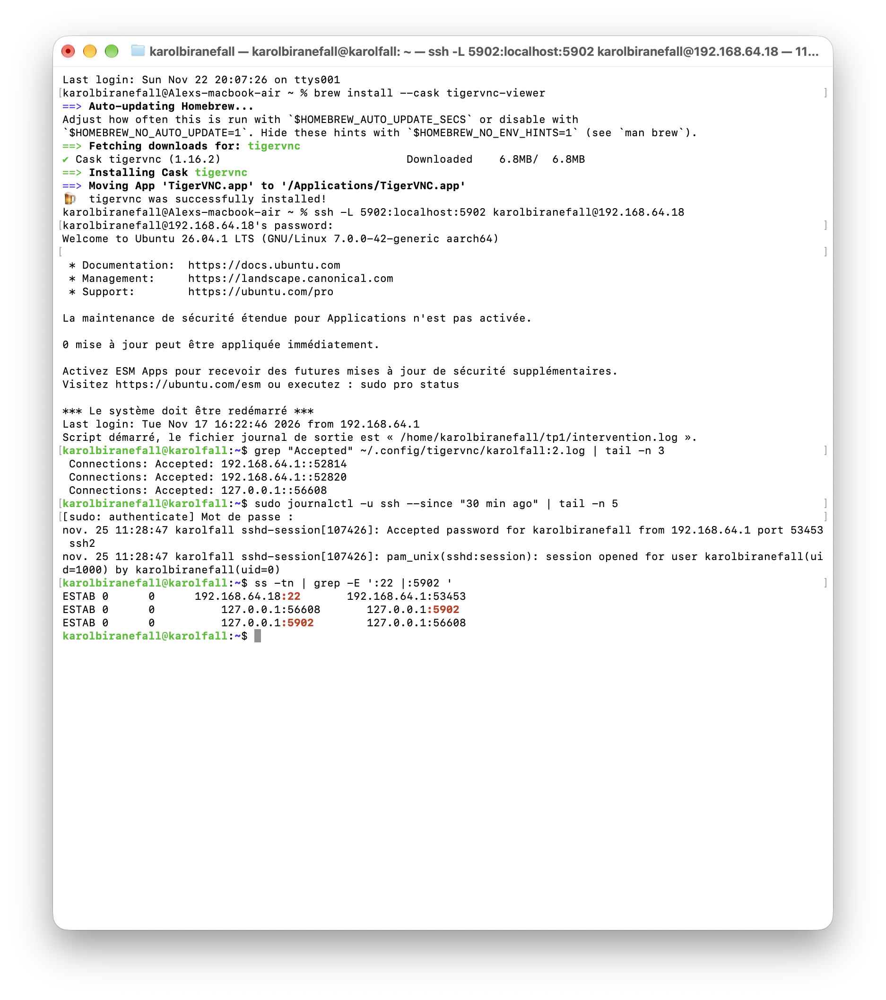

*Figure 11 – Journaux VNC et SSH, connexions actives*

---

# TP 2 – noVNC

Les étapes de mise à jour et d'installation de TigerVNC (étape 1.1 et 1.2), ainsi que la configuration de la session VNC et du fichier `xstartup` (étape 2), sont communes avec le TP 1 : la session `:2` déjà configurée est réutilisée.

## Étape 1 – Installation de noVNC et de Websockify

### noVNC

```bash
sudo apt install git -y
cd /opt
sudo git clone https://github.com/novnc/noVNC.git
cd /opt/noVNC
ls
```

Le dossier contient `vnc.html` (le client web) et `utils/` (le script `novnc_proxy`).

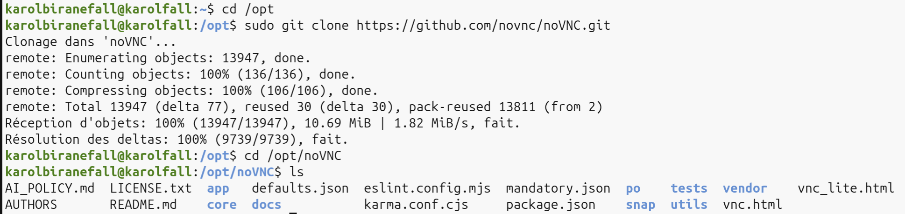

*Figure 12 – Clonage de noVNC dans /opt*

### Websockify

La commande `sudo pip3 install websockify` du sujet est bloquée sur Ubuntu 26.04 (« externally-managed-environment »). Le paquet officiel est installé avec `apt` :

```bash
sudo apt install websockify -y
which websockify
```

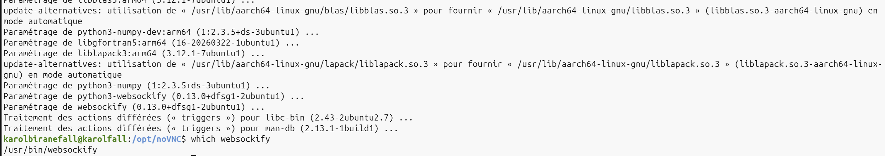

*Figure 13 – Installation de Websockify*

## Étape 3 – Lancement de noVNC et accès par le navigateur

```bash
cd /opt/noVNC
./utils/novnc_proxy --vnc localhost:5902
```

Websockify écoute sur le port **6080**, sert les pages de noVNC et relaie le trafic vers le serveur VNC (`localhost:5902`).

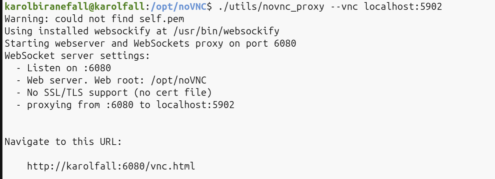

*Figure 14 – Lancement de novnc_proxy*

Depuis le navigateur du Mac : `http://192.168.64.18:6080/vnc.html`, bouton **Connecter**, puis mot de passe VNC. Le bureau s'affiche sans aucun client installé. Chrome indique « Not Secure » : la connexion n'est pas chiffrée.

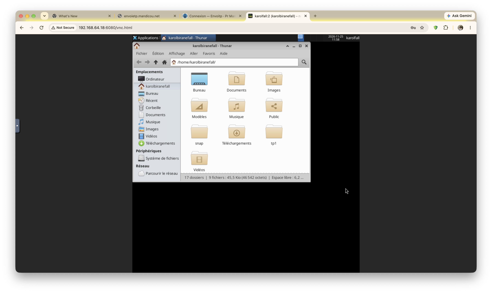

*Figure 15 – Bureau de la VM dans le navigateur via noVNC*

## Étape 5 – Sécurisation avec un tunnel SSH

noVNC est relancé pour n'écouter qu'en local, puis un tunnel SSH est créé depuis le Mac :

```bash
# Sur la VM
./utils/novnc_proxy --vnc localhost:5902 --listen localhost:6080

# Sur le Mac
ssh -L 6080:localhost:6080 karolbiranefall@192.168.64.18
```

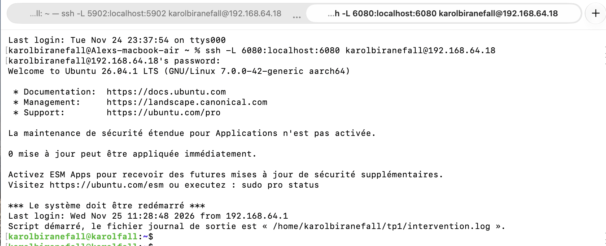

*Figure 16 – Tunnel SSH vers le port 6080*

Dans le navigateur, l'adresse devient `http://localhost:6080/vnc.html`. Le trafic suit le chemin : navigateur → tunnel SSH chiffré → Websockify → serveur VNC.

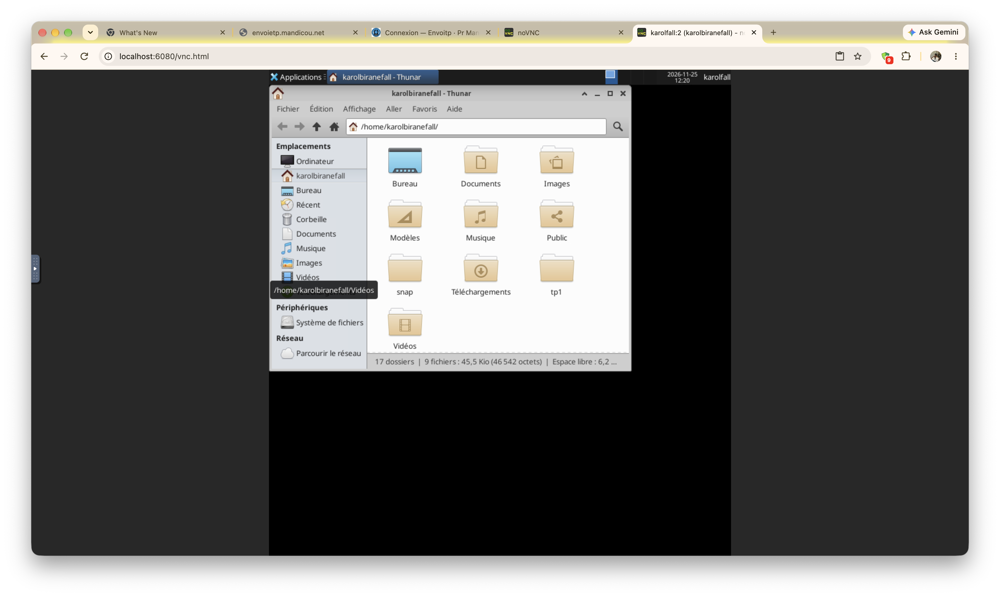

*Figure 17 – noVNC via localhost:6080 à travers le tunnel*

## Étape 6 – Tests et vérification

### 6.1 Connexion VNC

Les fonctionnalités ont été testées dans le navigateur (gestionnaire de fichiers, navigation dans les dossiers) : voir figures 15 et 17.

### 6.2 Stabilité du service : démarrage automatique

Sans configuration, VNC et noVNC ne redémarrent pas avec la machine. Deux services `systemd` ont été créés.

`/etc/systemd/system/vnc-tp.service` :

```ini
[Unit]
Description=Serveur TigerVNC (ecran :2)
After=network.target

[Service]
Type=forking
User=karolbiranefall
ExecStartPre=-/usr/bin/vncserver -kill :2
ExecStart=/usr/bin/vncserver :2 -xstartup /home/karolbiranefall/.config/tigervnc/xstartup
ExecStop=/usr/bin/vncserver -kill :2
Restart=on-failure

[Install]
WantedBy=multi-user.target
```

`/etc/systemd/system/novnc-tp.service` :

```ini
[Unit]
Description=noVNC (acces web au bureau VNC)
After=network.target vnc-tp.service
Wants=vnc-tp.service

[Service]
User=karolbiranefall
ExecStart=/opt/noVNC/utils/novnc_proxy --vnc localhost:5902 --listen localhost:6080
Restart=on-failure

[Install]
WantedBy=multi-user.target
```

Activation :

```bash
sudo systemctl daemon-reload
sudo systemctl enable --now vnc-tp.service novnc-tp.service
```

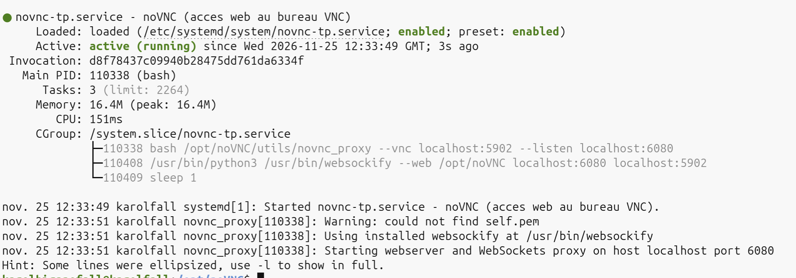

*Figure 18 – Service noVNC actif et activé au démarrage*

Après `sudo reboot`, sans rien lancer à la main, les deux services sont actifs. Le noyau affiché à la connexion est passé de `7.0.0-42` à `7.0.0-44`, ce qui confirme que la VM a bien redémarré.

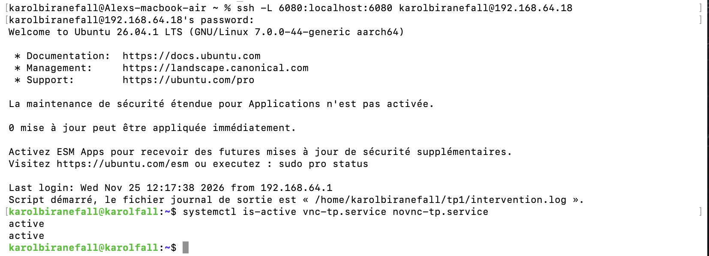

*Figure 19 – Services actifs après le redémarrage*

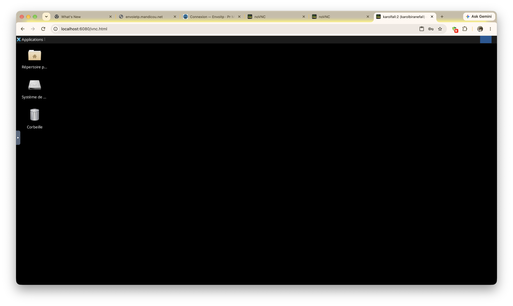

*Figure 20 – Accès noVNC fonctionnel après le redémarrage*

### 6.3 Questions de réflexion

**Quelle est l'utilité de Websockify dans l'architecture de noVNC ?**

Un navigateur ne peut pas ouvrir de connexion TCP brute vers un serveur VNC : il ne parle que HTTP et WebSocket, alors que VNC utilise le protocole RFB sur TCP. Websockify sert de passerelle : il reçoit les connexions WebSocket du navigateur (port 6080), transmet les données au serveur VNC en TCP (port 5902), et fait l'inverse pour les réponses. Il sert aussi de petit serveur web qui fournit au navigateur les fichiers de noVNC (option `--web /opt/noVNC`).

**Quelles sont les différences entre noVNC et les autres clients VNC standards ?**

| | noVNC | Client natif (TigerVNC Viewer, RealVNC…) |
|---|---|---|
| Type | Client web en HTML5 / JavaScript | Application installée |
| Installation côté client | Aucune, un navigateur suffit | Logiciel à installer |
| Connexion | Navigateur → WebSocket → Websockify → VNC | Directe en TCP vers le serveur (port 590x) |
| Composant supplémentaire | Websockify obligatoire sur le serveur | Aucun |
| Appareils | Tout appareil avec un navigateur | Ceux pour lesquels une application existe |

**Avantages et inconvénients de noVNC par rapport à une application VNC native**

| Avantages | Inconvénients |
|---|---|
| Aucun logiciel à installer ni à mettre à jour sur les clients | Un composant de plus (Websockify) à maintenir et sécuriser |
| Multiplateforme : PC, tablette, téléphone | Performances souvent inférieures (décodage en JavaScript, intermédiaire supplémentaire) |
| Passe plus facilement les pare-feu (trafic de type web) | Moins de fonctions avancées (presse-papiers, transfert de fichiers, multi-écrans) |
| S'intègre dans des portails web (consoles Proxmox, OpenStack) | Raccourcis clavier parfois interceptés par le navigateur ; service web supplémentaire exposé |

---

## Difficultés rencontrées

| Problème | Cause | Solution |
|---|---|---|
| `vncserver :1` refusé (« X11 server already running ») | Écran `:1` utilisé par la session GNOME de la VM | Utilisation de l'écran `:2` (port 5902) |
| Session VNC arrêtée au bout de 3 secondes | `startxfce4 &` : le script `xstartup` se termine immédiatement | `exec` au lieu de `&` |
| Authentification VNC refusée | Mot de passe VNC défini lors d'une séance précédente et oublié | Nouveau mot de passe avec `vncpasswd ~/.config/tigervnc/passwd` |
| Écran noir dans TigerVNC Viewer | XFCE se lançait en mode Wayland sur l'écran GNOME (variable `WAYLAND_DISPLAY` héritée) | `xstartup` complété (variables X11, `dbus-launch`) et paquet `dbus-x11` installé |
| RealVNC Viewer inutilisable sans compte | Nouvelle politique de RealVNC | TigerVNC Viewer, gratuit et open source |
| `pip3 install websockify` bloqué | Protection « externally-managed-environment » d'Ubuntu 26.04 | `sudo apt install websockify` |
| Services absents après redémarrage | Lancements manuels uniquement | Services `systemd` `vnc-tp` et `novnc-tp` |

## Conclusion

Ces TP montrent deux façons de prendre le contrôle d'une machine Linux à distance : avec un client VNC natif, et depuis un simple navigateur grâce à noVNC et Websockify. VNC ne chiffrant pas ses échanges, le tunnel SSH est indispensable : en limitant VNC et noVNC à `localhost`, seul le port 22 reste exposé sur le réseau. Enfin, les services `systemd` rendent la solution utilisable en conditions réelles, puisqu'elle redémarre seule avec la machine.
